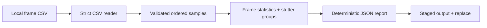

# FrameTrace

**Offline game frame-time diagnostics | Python 3.10+ | reproducible CSV-to-JSON analysis**

FrameTrace is an independent Python project that reads local frame-duration samples, computes explicit frame-time metrics, and groups consecutive slow frames into stutter events. It helps investigate repeatable performance patterns without claiming to identify their CPU, GPU, or network root cause.

**Engineering focus:** stable statistics, strict CSV input validation, safe report writing, deterministic fixtures, and cross-platform regression tests.

[Engineering case study](docs/case-study.md) · [Sample input](examples/frames.csv) · [Reproducible JSON report](evidence/sample-frame-report.json) · [Validation evidence](evidence/validation.md)

## What the sample shows

The committed **12-frame synthetic fixture** produces the following deterministic values. These are invented timings, **not real game FPS measurements**.

| Metric | Sample result |
| --- | ---: |
| Frames analyzed | 12 |
| Mean FPS (inverse mean frame time) | 44.33 |
| Median frame time | 16.75 ms |
| p95/p99 frame time | 45.1 / 45.1 ms |
| Approximate 1% low FPS | 22.17 |
| Stutter threshold | 33.3 ms (inclusive) |
| Stutter frames and runs | 3 frames / 2 runs |

FrameTrace distinguishes the **number of slow frames** from the **number of contiguous stutter events**. The reported FPS figures are summaries of the supplied frame durations, not measurements of a connected game client.

## Quick start

Requires Python **3.10 or newer**, uses only the standard library at runtime, and has no external runtime dependencies.

```bash
python -m pip install -e .
python -m frametrace --input examples/frames.csv --output frame-report.json --stutter-ms 33.3
python -m unittest discover -s tests -v
```

The output file is formatted JSON. Use an output path different from the input CSV; the CLI rejects same-file aliases. A complete report is first written to a temporary file in the destination directory and then replaced, so an invalid input cannot truncate an existing report.

## Architecture



The core logic lives in [`src/frametrace/core.py`](src/frametrace/core.py), with the CLI in [`src/frametrace/__main__.py`](src/frametrace/__main__.py). The test suite covers the library and the real CLI subprocess.

## Input contract

Header, in this exact order:

```csv
timestamp_ms,frame_time_ms
```

- **`timestamp_ms`:** finite, non-negative, strictly increasing timestamp, in milliseconds.
- **`frame_time_ms`:** finite, strictly positive duration, in milliseconds.
- Exactly two CSV columns per record; extra, missing and duplicate columns are rejected instead of silently ignored.
- A blank physical line is ignored. Malformed records raise a descriptive error with the input file and source line.
- UTF-8 BOM is supported. No network calls or game clients are involved.

## Metrics

- **Mean FPS:** `1000 / mean(frame_time_ms)`, *not* an arithmetic average of individual FPS readings.
- **Median frame time:** the median of accepted frame durations.
- **p95 and p99:** nearest-rank percentiles from ascending frame durations.
- **Approximate 1% low FPS:** `1000 / mean(slowest max(1, ceil(1% × sample_count)) frame times)`.
- **Stutter event:** a maximal sequence of consecutive samples with `frame_time_ms >= stutter_ms`. Each event reports its first/last timestamps, frame count, and peak frame duration.

Non-finite values and metrics that cannot be represented as finite JSON numbers are rejected. FrameTrace does **not** distinguish rendering, scheduling, presentation or network latency causes.

## Verified tests

The Python unit suite exercises CSV headers, ordering, malformed rows, missing samples, non-finite values, percentile boundaries, 1% low sample selection, stutter event grouping, and the exact committed JSON fixture. CLI tests exercise file aliases, hard links, rejected inputs, replacing existing reports safely, and process exit status.

**GitHub Actions verified:** Python **3.10, 3.11 and 3.12** on **Ubuntu and Windows** all passed ([successful PR run](https://github.com/Preciouscrazy/FrameTrace/actions/runs/43692731951)). See the [validation record](evidence/validation.md) for the exact tested commit, all six matrix combinations, and reproduction instructions.

## Boundaries

This is an offline educational analyzer: it does not connect to Riot Games, monitor real accounts, record GPU utilization, capture network packets, profile live games, or attribute a cause to slow frames. Metrics depend on frame capture methodology and may not represent displayed frames or one-way latency. Its 1% low estimate is a documented convention, not a universal performance standard.

MIT licensed. See [LICENSE](LICENSE).
