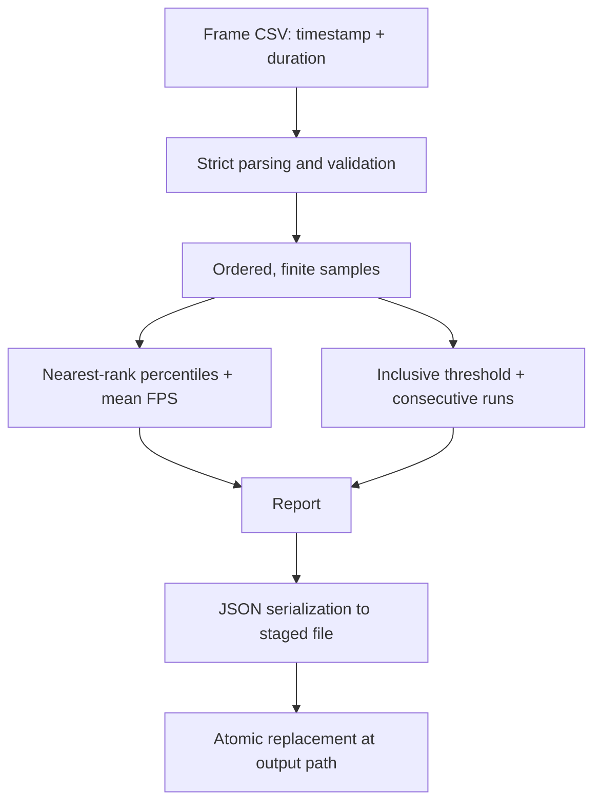

# FrameTrace — Engineering case study

**Project:** Python offline frame-time analyzer · **Interface:** strict CSV input and JSON report

[Repository overview](../README.md) · [Example frame samples](../examples/frames.csv) · [Sample report](../evidence/sample-frame-report.json) · [Validation status](../evidence/validation.md)

## Problem

A single average FPS number conceals temporary slow frames. For example, a mostly steady sample can still include consecutive frames substantially above a selected stutter threshold. FrameTrace provides reproducible measurements of the frame-time distribution and groups slow samples into discrete events, instead of suggesting an unverified CPU, GPU, or network diagnosis.

The input is entirely synthetic or supplied by the user; this project does not capture another application's frame timings.

## System design

- [`core.load_frames`](../src/frametrace/core.py) requires the exact two-column header, validates non-negative monotonic timestamps and positive finite frame durations, and reports the source line for malformed rows.
- [`core.analyze`](../src/frametrace/core.py) validates direct caller inputs rather than trusting only the CSV reader; it computes reproducible summary statistics and contiguous stutter events.
- [`__main__.py`](../src/frametrace/__main__.py) handles CLI arguments, rejects input/output file aliases (including existing hard links), serializes the entire JSON report before writing, and stages it in the destination directory prior to replacement.

The staging change is designed to keep existing destination data intact if parsing or report serialization fails. It does not promise recovery from power loss or concurrent writers.

## Engineering decisions

**Use frame-time statistics, not causal labels.** Mean FPS is the inverse mean frame duration (milliseconds). Nearest-rank p95/p99 expose slow-tail durations. Frame-time measurements alone cannot distinguish CPU stalls, GPU stalls, graphics drivers, scheduling, presentation delays, or network conditions.

**Define a stutter event as a run.** Each consecutive accepted sample with `duration >= threshold` contributes to one event until a faster frame breaks the run. The event stores first and last sample timestamps, the count, and the peak. A missing sample is not reconstructed.

**Make invalid data visible.** A malformed CSV row, duplicate/extra header, extra column, non-finite number, negative timestamp, or non-increasing timestamp fails with an error instead of silently producing a partial report. The same constraints are enforced when Python callers use `analyze` directly.

**Avoid report/input collisions.** Rejecting equivalent input/output paths protects input samples. Writing to a temporary file and replacing the destination prevents a parsing failure from truncating an existing report.

## Evidence

The [12-row sample](../examples/frames.csv) produces a [checked-in JSON report](../evidence/sample-frame-report.json) with **44.33 mean FPS**, **16.75 ms median frame duration**, **45.1 ms p95/p99**, an approximately **22.17 FPS 1% low**, and **three stutter frames in two events** using a **33.3 ms** threshold. All numbers are synthetic sample calculations, not game performance measurements.

The expanded tests verify parsing boundaries, time ordering, percentile conventions, event grouping, non-finite and extreme numeric values, source-file safety, subprocess exit codes, and golden report equality. GitHub Actions runs these tests across Python 3.10, 3.11, and 3.12 on Ubuntu and Windows. See the [validation record](../evidence/validation.md) for checked run links and counts.

## Complexity

For `n` frames, analysis computes a median, nearest-rank percentiles, and slowest-1% subset by sorting: **O(n log n)** time. Stutter grouping is **O(n)**. The reader stores all samples, and sorting creates additional lists: **O(n)** space. For high-volume continuous capture, a streaming histogram/quantile approximation could bound memory but would change the percentile semantics.

## Limitations and future experiments

- A twelve-frame demonstration is too small to characterize real workload behavior.
- Source timestamps are ordered, but actual on-screen frame presentation timing depends on instrumentation and scheduling.
- Missing samples can change the apparent continuity of a stutter run.
- No CPU/GPU telemetry, network measurements, live capture, or commercial-game integration.
- The report replaces an existing destination after successful staging; simultaneous writers are not coordinated.
- Follow-up experiments could compare different stutter thresholds, add larger synthetic distributions, and validate capture probes in software under the developer's control.

## Interview-ready explanation

> I built FrameTrace to analyze frame duration sequences without relying on a live game or guessing at bottlenecks. The tool validates monotonic timestamps, computes explicitly defined percentiles and an approximate 1% low, and groups consecutive slow frames into stutter events. I expanded tests for malformed inputs and metric boundaries and updated the CLI so invalid input cannot overwrite the CSV or truncate an existing report. I use fixed sample data and compare the generated JSON against a committed reference, then verify the test suite on Windows and Ubuntu across three Python versions. These are synthetic diagnostics, not proof of improvements to a real game's frame rate.
